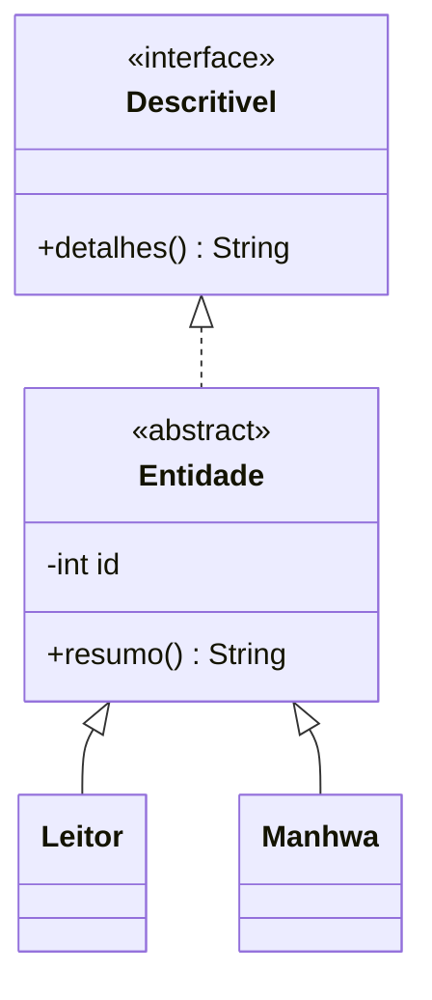
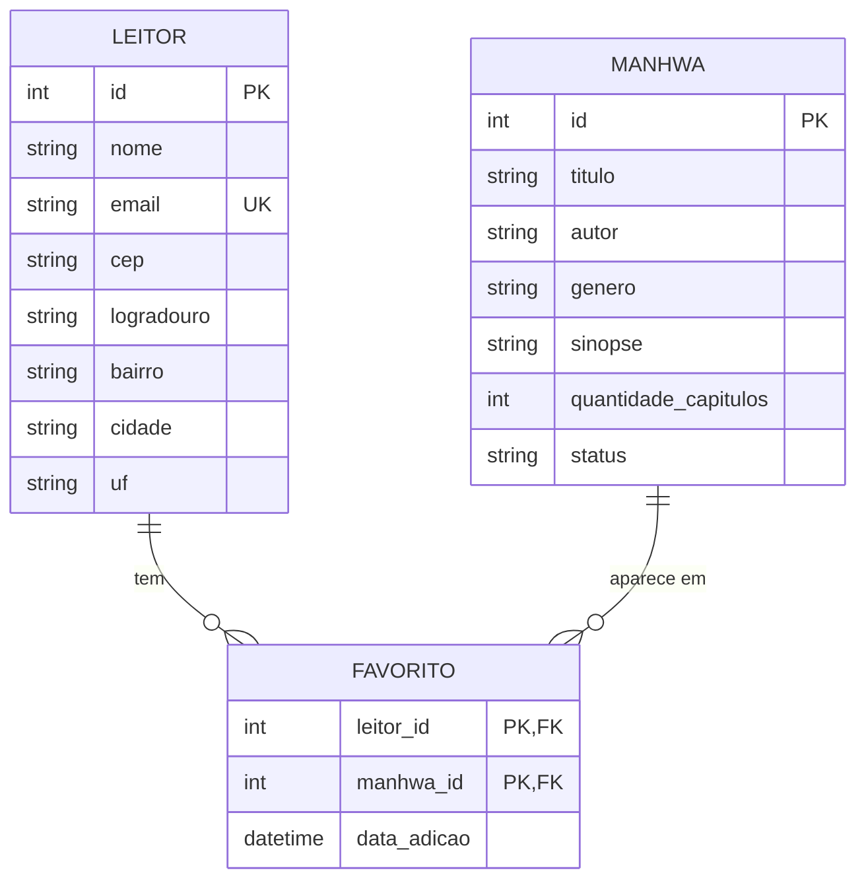

# Vellum - Biblioteca Digital de Manhwas

Projeto acadêmico desenvolvido para o Desafio Extra (CRUD com Integração) da disciplina de Programação Orientada a Objetos.

Autora: Maria de Jesus Silva dos Santos

## Sumário

- [Sobre o projeto](#sobre-o-projeto)
- [Funcionalidades](#funcionalidades)
- [Tecnologias](#tecnologias)
- [Requisitos](#requisitos)
- [Como executar](#como-executar)
- [Configuração (arquivo .env)](#configuração-arquivo-env)
- [Como usar o menu](#como-usar-o-menu)
- [Estrutura do projeto](#estrutura-do-projeto)
- [Banco de dados](#banco-de-dados)
- [Validações](#validações)
- [Padrões de projeto](#padrões-de-projeto)
- [Assuntos de POO aplicados no projeto](#assuntos-de-poo-aplicados-no-projeto)
- [Problemas comuns](#problemas-comuns)

## Sobre o projeto

O Vellum é uma biblioteca digital fictícia de manhwas, com tema de fantasia/RPG, executada no terminal. Leitores se registram na guilda, manhwas são cadastrados no acervo e cada leitor pode guardar seus manhwas favoritos.

## Funcionalidades

- CRUD completo de **Leitores** (nome, email, CEP e endereço).
- CRUD completo de **Manhwas** (título, autor, gênero, sinopse, quantidade de capítulos e status).
- Relação entre as entidades: **Favoritos** (um leitor pode favoritar vários manhwas, e um manhwa pode ser favoritado por vários leitores).
- Consulta de endereço pelo CEP usando a API pública **ViaCEP**.
- Menu interativo com `Scanner` e validação das entradas.
- Backup do acervo de manhwas em arquivo, usando serialização.

## Tecnologias

- Java 21
- Maven (com Maven Wrapper incluído: não é preciso instalar o Maven)
- MySQL 8 (acesso via JDBC)

Dependências declaradas no `pom.xml` (o Maven baixa tudo automaticamente):

- `mysql-connector-j` 8.4.0 (conexão com o MySQL)
- `dotenv-java` 3.0.0 (leitura do arquivo `.env`)
- `gson` 2.10.1 (leitura da resposta JSON do ViaCEP)

## Requisitos

1. **JDK 21.** Confira com `java -version`.
2. **MySQL 8 ligado** na porta `3306`. Por padrão o projeto usa o usuário `root` **sem senha**; se o seu MySQL for diferente, veja "Configuração (arquivo .env)".
3. **Conexão com a internet** (download das dependências na primeira execução e consulta de CEP).
4. **Git** (opcional): você também pode baixar o repositório em ZIP pelo GitHub.

Instalação por sistema:

| Sistema | JDK 21 | MySQL 8 |
|---|---|---|
| Windows | Instalador do Temurin: https://adoptium.net | MySQL Installer: https://dev.mysql.com/downloads/installer/ |
| macOS (Homebrew) | `brew install --cask temurin@21` | `brew install mysql` e `brew services start mysql` |
| Linux (Debian/Ubuntu) | `sudo apt install openjdk-21-jdk` | `sudo apt install mysql-server` e `sudo systemctl start mysql` |

Em outras distribuições Linux, use o gerenciador de pacotes da sua distribuição.

## Como executar

Primeiro, baixe o projeto e entre na pasta:

```
git clone https://github.com/jisuissantos-dev/Vellum.git
cd Vellum
```

### Windows (PowerShell ou Prompt de Comando)

```
.\executar.bat
```

Ou, sem o script:

```
copy .env.example .env
.\mvnw.cmd -q compile exec:java "-Dexec.mainClass=br.edu.poo.m0013.Main"
```

### macOS e Linux

```
sh executar.sh
```

Ou, sem o script:

```
cp .env.example .env
sh ./mvnw -q compile exec:java "-Dexec.mainClass=br.edu.poo.m0013.Main"
```

### IntelliJ IDEA (qualquer sistema)

1. Abra a pasta do projeto e aguarde o Maven baixar as dependências.
2. Na raiz do projeto, copie o arquivo `.env.example` e renomeie a cópia para `.env`.
3. Execute a classe `br.edu.poo.m0013.Main`.

Os scripts `executar.bat` e `executar.sh` criam o `.env` automaticamente, caso ele ainda não exista. Na primeira execução o Maven baixa as dependências, então pode demorar um pouco.

Em todos os casos não é necessário criar o banco ou as tabelas: ao iniciar, o programa cria o banco `vellum` e as tabelas `leitor`, `manhwa` e `favorito`, caso ainda não existam.

## Configuração (arquivo .env)

As configurações ficam no arquivo `.env`, na raiz do projeto. Ele **não acompanha o repositório**: o que acompanha é o `.env.example`, com os valores padrão. Os scripts de execução criam o `.env` a partir dele; se você executar pelo IntelliJ, copie o arquivo manualmente (veja "Como executar").

- `DB_URL`: endereço do banco de dados (MySQL local, porta `3306`, banco `vellum`).
- `DB_USER`: usuário do MySQL (padrão: `root`).
- `DB_PASSWORD`: senha do MySQL (padrão: vazia).
- `API_VIACEP_URL`: endereço base da API ViaCEP.

Se o MySQL da sua máquina usar outro usuário ou tiver senha (o caso de muitas instalações novas), ajuste `DB_USER` e `DB_PASSWORD` no `.env`.

**Importante:** o `.env` contém configurações locais e não é enviado ao repositório público (está no `.gitignore`).

## Como usar o menu

O menu tem 13 opções, divididas em quatro áreas, mais a opção de sair:

- **Guilda dos Leitores (1 a 4):** registrar, listar, atualizar e remover leitores. No cadastro, o CEP é opcional (Enter para pular) e pode ser informado depois em "Atualizar leitor". Ao atualizar, aperte Enter para manter o valor atual de cada campo.
- **Acervo de Manhwas (5 a 8):** registrar, listar, atualizar e remover manhwas. O status pode ser "Em publicação" ou "Finalizada".
- **Grimório de Favoritos (9 a 11):** favoritar um manhwa para um leitor, ver os favoritos de um leitor e remover um favorito.
- **Backup do Acervo (12 e 13):** salva todos os manhwas em um arquivo (`backup_manhwas.dat`, criado na pasta do projeto) e depois lê esse arquivo e mostra o conteúdo.
- **0:** sair.

Observações:

- O e-mail do leitor é único: não é possível cadastrar dois leitores com o mesmo e-mail.
- Remover um leitor remove também os favoritos dele, e remover um manhwa o retira dos favoritos de todos os leitores.
- Cidades pequenas têm CEP único, então a consulta pode retornar só a cidade e a UF, sem rua e bairro.
- Os IDs são gerados pelo MySQL (`AUTO_INCREMENT`) e não são reaproveitados depois de uma remoção.
- O backup é uma cópia dos manhwas em arquivo: ele não altera o banco e não restaura dados, apenas guarda e mostra o que estava salvo no momento da opção 12.

## Estrutura do projeto

Pacote raiz: `br.edu.poo.m0013`

```
Vellum/
├── pom.xml                      dependências e configuração do Maven
├── mvnw, mvnw.cmd, .mvn/        Maven Wrapper (não exige Maven instalado)
├── executar.sh, executar.bat    scripts de execução (macOS/Linux e Windows)
├── .env.example                 modelo de configuração (copie para .env)
├── .gitignore, .gitattributes
├── README.md
└── src/main/java/br/edu/poo/m0013/
    ├── Main.java                ponto de entrada
    ├── api/
    │   ├── EnderecoViaCep.java      resposta da API (mapeada pelo Gson)
    │   └── ViaCepClient.java        consulta do CEP via HTTP
    ├── dao/
    │   ├── LeitorDAO.java           CRUD de leitores
    │   ├── ManhwaDAO.java           CRUD de manhwas
    │   └── FavoritoDAO.java         relação leitor-manhwa
    ├── database/
    │   ├── ConexaoComBanco.java     abre a conexão JDBC
    │   └── InicializadorBanco.java  cria as tabelas, se não existirem
    ├── exception/
    │   └── DadoInvalidoException.java
    ├── model/
    │   ├── Descritivel.java         interface
    │   ├── Entidade.java            classe abstrata (id)
    │   ├── Leitor.java
    │   ├── Manhwa.java
    │   └── StatusManhwa.java        enum
    ├── ui/
    │   ├── MenuPrincipal.java       menu e despacho das opções
    │   ├── MenuLeitor.java
    │   ├── MenuManhwa.java
    │   ├── MenuFavorito.java
    │   ├── MenuBackup.java
    │   ├── Entrada.java             leitura e validação do que é digitado
    │   └── Exibicao.java            impressão polimórfica de entidades
    └── util/
        ├── Validador.java           validação de e-mail e CEP
        ├── Configuracao.java        Singleton que lê o .env
        ├── BackupManhwa.java        serialização do acervo
        └── TarefaBackup.java        Thread que executa o backup
```

Fluxo de uma operação (organização em camadas):

```
ui (menus e Entrada)  →  model / util (regras e validações)
        │
        ├──→ dao  →  database (JDBC)  →  MySQL
        └──→ api  →  ViaCEP
```

Hierarquia do modelo:



`Entidade` também implementa `Serializable`, o que permite gravar os manhwas no backup.

## Banco de dados

O banco `vellum` tem três tabelas. `leitor` e `manhwa` têm um relacionamento muitos-para-muitos, resolvido pela tabela `favorito`.



### Tabela `leitor`

| Coluna | Tipo | Regras |
|---|---|---|
| `id` | `INT` | chave primária, `AUTO_INCREMENT` |
| `nome` | `VARCHAR(100)` | obrigatório |
| `email` | `VARCHAR(100)` | obrigatório, **único** |
| `cep` | `CHAR(8)` | opcional |
| `logradouro` | `VARCHAR(100)` | opcional (preenchido pelo ViaCEP) |
| `bairro` | `VARCHAR(100)` | opcional (preenchido pelo ViaCEP) |
| `cidade` | `VARCHAR(50)` | opcional (preenchido pelo ViaCEP) |
| `uf` | `CHAR(2)` | opcional (preenchido pelo ViaCEP) |

### Tabela `manhwa`

| Coluna | Tipo | Regras |
|---|---|---|
| `id` | `INT` | chave primária, `AUTO_INCREMENT` |
| `titulo` | `VARCHAR(100)` | obrigatório |
| `autor` | `VARCHAR(100)` | obrigatório |
| `genero` | `VARCHAR(100)` | opcional |
| `sinopse` | `TEXT` | opcional |
| `quantidade_capitulos` | `INT` | obrigatório, padrão `0` |
| `status` | `ENUM('EM_PUBLICACAO','FINALIZADA')` | obrigatório |

### Tabela `favorito`

| Coluna | Tipo | Regras |
|---|---|---|
| `leitor_id` | `INT` | obrigatório, chave estrangeira para `leitor(id)` |
| `manhwa_id` | `INT` | obrigatório, chave estrangeira para `manhwa(id)` |
| `data_adicao` | `TIMESTAMP` | obrigatório, padrão: data e hora atuais |

- A chave primária é **composta** (`leitor_id` + `manhwa_id`): o mesmo leitor não favorita o mesmo manhwa duas vezes.
- As duas chaves estrangeiras usam `ON DELETE CASCADE`: ao remover um leitor ou um manhwa, os favoritos relacionados são removidos junto.
- As tabelas são criadas por `InicializadorBanco` com `CREATE TABLE IF NOT EXISTS`, e o banco `vellum` é criado pela própria URL de conexão.

## Validações

As validações acontecem em camadas, para que um dado inválido seja barrado o mais cedo possível:

**1. Na entrada de dados (`Entrada` e `Validador`)**

- Campos obrigatórios não aceitam texto vazio (o programa pergunta de novo).
- Números inteiros precisam ser válidos; capítulos não podem ser negativos.
- E-mail precisa conter `@` e não pode ter espaços.
- CEP precisa ter exatamente 8 números (o hífen é aceito e removido).
- Status só aceita as opções `1` ou `2`.
- Remoções pedem confirmação (`s/n`).
- IDs inexistentes geram a mensagem "não encontrado".

**2. No modelo (`Leitor` e `Manhwa`)**

Os métodos `set` lançam `DadoInvalidoException` quando o valor é inválido:

- Leitor: nome não vazio, e-mail com `@`, CEP com 8 dígitos e UF com 2 letras.
- Manhwa: título e autor não vazios, quantidade de capítulos maior ou igual a 0 e status não nulo.

**3. Na integração com o ViaCEP (`ViaCepClient`)**

- CEP com tamanho diferente de 8 é recusado.
- CEP inexistente retorna uma mensagem e o leitor é salvo sem endereço.
- Falha de rede ou da API gera uma mensagem, e o cadastro continua possível.

**4. No banco de dados**

- `NOT NULL` nos campos obrigatórios, e-mail `UNIQUE`, chaves estrangeiras e chave primária composta em `favorito`.

**5. Tratamento de erros (`MenuPrincipal`)**

Qualquer falha que chegue ao menu é tratada sem encerrar o programa:

- `SQLIntegrityConstraintViolationException`: dado repetido (e-mail ou favorito) ou vínculo inexistente.
- `SQLException`: erro de banco, com a mensagem original.
- `IllegalArgumentException` (inclui `DadoInvalidoException`): mensagem de validação.

## Padrões de projeto

### DAO (Data Access Object)

Cada entidade tem uma classe responsável apenas pelo acesso ao banco: `LeitorDAO`, `ManhwaDAO` e `FavoritoDAO`. Os menus não escrevem SQL: chamam métodos como `inserir()`, `listarTodos()`, `buscarPorId()`, `atualizar()` e `deletar()`. As consultas usam `PreparedStatement` e as conexões são fechadas automaticamente com `try-with-resources`. Se o banco mudasse, apenas os DAOs seriam alterados.

### Singleton

A classe `Configuracao` lê o arquivo `.env` uma única vez e mantém uma única instância durante toda a execução:

- o construtor é `private`;
- `getInstancia()` cria a instância na primeira chamada e a reutiliza depois (é `synchronized`);
- `ConexaoComBanco` e `ViaCepClient` obtêm as configurações por ela.

### Organização em camadas

Não é um padrão de projeto clássico, mas guia a estrutura: a interface (`ui`) conversa com o modelo, os DAOs e a API; os DAOs usam a camada `database`; e nenhuma camada de baixo conhece a de cima.

## Assuntos de POO aplicados no projeto

| Assunto | Onde aparece |
|---|---|
| Variáveis, `final` e String | Constantes `final` (ex.: `BackupManhwa.ARQUIVO`) e métodos de String (`trim`, `isBlank`, `replace`) |
| Classes e objetos | Entidades do `model`, DAOs e menus |
| Construtores e atributos privados | `Leitor` e `Manhwa`: atributos `private`, construtores e getters/setters com validação |
| Retorno de função | Métodos como `listarTodos()`, `buscarPorId()` e `emailValido()` |
| Laços e condicionais | Menus, leituras validadas e listagens |
| Herança | `Leitor` e `Manhwa` estendem `Entidade`; `DadoInvalidoException` estende `IllegalArgumentException`; `TarefaBackup` estende `Thread` |
| Classe abstrata | `Entidade` |
| Interface | `Descritivel` |
| Polimorfismo e ligação | `Exibicao.mostrar(Entidade)` executa o `resumo()` e o `detalhes()` do objeto real (Leitor ou Manhwa) |
| Arrays | Linhas do menu (`MenuPrincipal`) e `Manhwa[]` no backup |
| Tratamento de exceções | `try/catch`, `throw` e a exceção própria `DadoInvalidoException` (veja "Validações") |
| Entrada de dados | `Scanner` na classe `Entrada`, com validação |
| Serialização | `BackupManhwa` grava e lê o acervo com `ObjectOutputStream` e `ObjectInputStream` |
| Threads | `TarefaBackup` executa o backup em uma `Thread`; o menu espera com `join()` |
| Padrões de projeto | **DAO** e **Singleton** (veja "Padrões de projeto") |

## Problemas comuns

- **"Não foi possível preparar o banco de dados" ou "Erro no banco de dados"**: confira se o MySQL está ligado, se a porta é `3306` e se o usuário e a senha do `.env` estão corretos.
- **`Access denied for user`**: o usuário ou a senha do `.env` não conferem com o seu MySQL. Ajuste `DB_USER` e `DB_PASSWORD`. Em algumas instalações Linux, o `root` só entra com `sudo`; nesse caso, crie um usuário para o projeto e use-o no `.env`.
- **Erro ao iniciar mencionando o arquivo `.env`**: o arquivo `.env` não foi criado. Copie o `.env.example` na raiz do projeto e renomeie a cópia para `.env`.
- **`'java' não é reconhecido` / `java: command not found`**: o JDK não está instalado ou não está no PATH. Instale o JDK 21 e confira com `java -version`.
- **Erro de versão do Java (ex.: "release version 21 not supported")**: o JDK instalado é mais antigo que o 21.
- **Acentos estranhos no terminal do Windows**: use o `executar.bat`, que ajusta a codificação, ou rode `chcp 65001` antes do comando.
- **Erro ao consultar o CEP**: verifique sua conexão com a internet e se a API ViaCEP está disponível. O leitor ainda pode ser cadastrado sem CEP.
- **"CEP não encontrado no ViaCEP"**: o CEP digitado não existe. Informe outro, ou deixe em branco e preencha depois.
- **"Nenhum backup encontrado"**: use primeiro a opção 12 para salvar o backup e depois a 13 para ver.